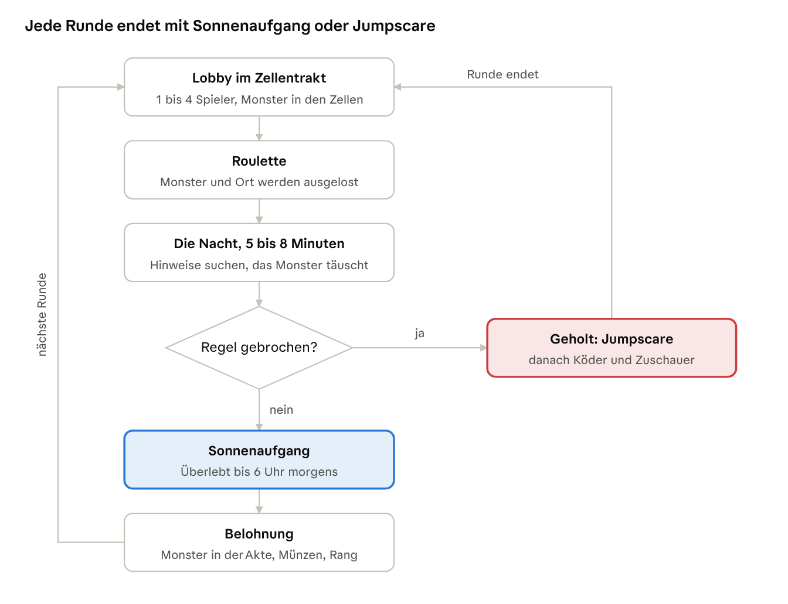
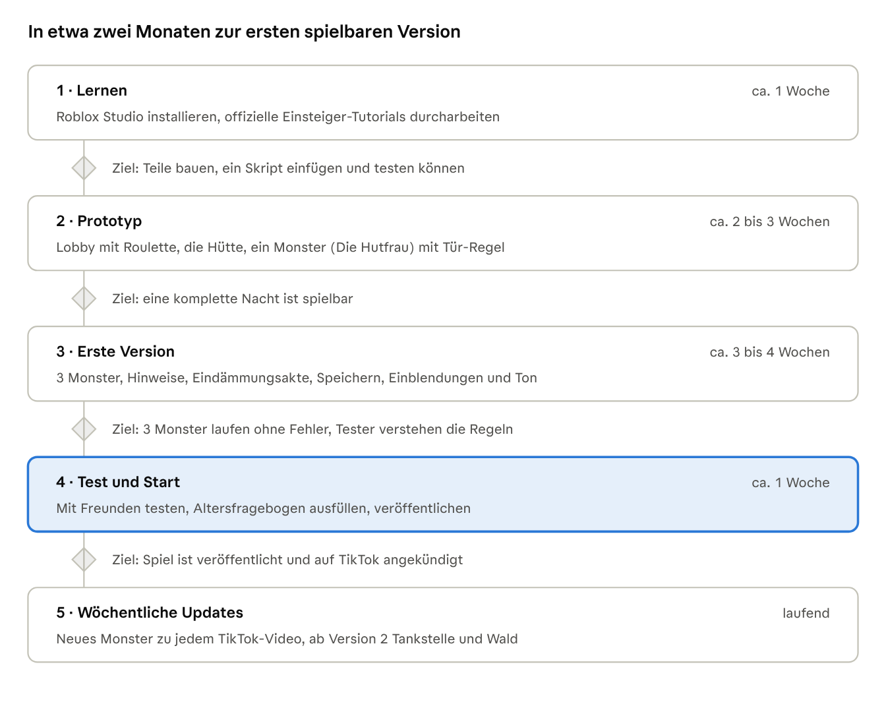

# Horror Roulette – Spielkonzept (Roblox)

Stand: 17.11.2026 · Online-Fassung zum Bearbeiten: https://claude.ai/artifact/J3a2FuUaM8vTKSz5UZifPz

## Überblick

Ein Roulette entscheidet, welches Monster heute Nacht ausbricht – und die Spieler überleben bis zum Sonnenaufgang nur, wenn sie seine eine Regel herausfinden und befolgen.

| Punkt | Festlegung |
| --- | --- |
| Genre | Koop-Horror mit Regel-Rätseln (Atmosphäre und Ton statt Gewalt) |
| Plattform | Roblox (PC, Handy, Tablet, Konsole) |
| Spieler | 1–4 pro Runde, Koop |
| Rundenlänge | 5–8 Minuten |
| Zielgruppe | Horror-Fans ab ca. 13, gleiche Zielgruppe wie die TikTok-Serie |
| Herzstück | Jede Runde ein anderes Monster mit anderer Regel – wie in den Videos |

## Spielablauf

Eine Runde dauert 5–8 Minuten und führt immer zurück in die Lobby – überlebt mit Belohnung oder geholt als Zuschauer.

1. **Lobby im Zellentrakt** – 1 bis 4 Spieler, Monster stehen in den Zellen.
2. **Roulette** – Monster und Ort werden ausgelost.
3. **Die Nacht (5–8 Minuten)** – Hinweise suchen, das Monster täuscht.
4. **Entscheidung: Regel gebrochen?**
   - **Ja →** Geholt: Jumpscare, danach Köder und Zuschauer. Runde endet → zurück zur Lobby.
   - **Nein →** Sonnenaufgang: überlebt bis 6 Uhr morgens.
5. **Belohnung** – Monster in der Akte, Münzen, Rang → nächste Runde.

Wer die Regel bricht, ist für diese Runde raus, die anderen spielen weiter bis zum Sonnenaufgang.

## Monster & Regeln

Die erste Version startet mit 3 Monstern, deren Regeln sich grundsätzlich unterscheiden: eine Tür-Regel, eine Geräusch-Regel und eine Blick-Regel. Zwei davon sind eigene Figuren, damit die Rechte bei dir liegen.

| Monster | Herkunft | Regel | Hinweise im Level | Wie es täuscht | Regel gebrochen |
| --- | --- | --- | --- | --- | --- |
| Die Hutfrau | Japanische Sage (Hachishakusama) | Öffne keine Tür bis zum Sonnenaufgang | „Po… po…“-Geräusch, Zettel von Oma, Salz in den Ecken | Klopft mit der Stimme eines Mitspielers: „Mach auf, ich bin's“ | Tür öffnet sich, Hut im Türrahmen, Jumpscare |
| Der Schreier | Eigene Figur (Lautsprecher-Wesen) | Mach kein Geräusch | Radio springt von selbst, Lautsprecher knistern, Notiz „Er ist blind“ | Spielt Hilferufe und Namen der Spieler ab | Rennen, Türen knallen oder Dinge fallen lassen lockt ihn an |
| Der Gesichtslose | Eigene Figur (groß, ohne Gesicht) | Renn nicht – und schau ihn nur durch die Kamera an | Kamera rauscht, je näher er ist; Bild zeigt ihn, Auge nicht | Taucht hinter Mitspielern auf, bewegt sich nur, wenn niemand hinsieht | Wer rennt, wird geholt |

So funktioniert eine Regel im Spiel:

1. Die Spieler wissen am Anfang nicht, welche Regel gilt.
2. Hinweise im Level (Zettel, Radio, Geräusche) verraten sie Schritt für Schritt.
3. Das Monster versucht, sie zum Regelbruch zu verleiten – mit Stimmen, Klopfen, falschen Hinweisen.
4. Wer die Regel bricht, wird geholt. Die anderen spielen weiter.

Ideen für spätere Updates (Folklore oder eigene Figuren, Regel jeweils neu):

- Kuchisake-Onna: Beantworte ihre Frage richtig („Bin ich hübsch?“)
- Teke Teke: Überquere nachts keine Gleise
- Hanako-san: Klopf nie dreimal an die dritte Kabine
- Mothman: Wenn du ihn siehst, ändere deinen Weg
- Wendigo: Lass das Feuer nie ausgehen

## Schauplätze

Das Roulette wählt Monster und Schauplatz getrennt, so entstehen aus 3 Monstern und 3 Orten schon 9 verschiedene Nächte. Die erste Version braucht nur einen Ort: die Hütte.

| Ort | Aufbau | Was man benutzen kann | Ab Version |
| --- | --- | --- | --- |
| Hütte im Schnee | 4 Zimmer, Flur, Haustür, Fenster mit Vorhängen, Veranda | Türen abschließen, Kamin, Laterne, Radio, Zettel | 1 |
| Tankstelle im Wald | Verkaufsraum, Lager, Toilette, Zapfsäulen, Straße | Licht aus/an, Durchsage-Anlage, Kasse, Funkgerät | 2 |
| Herbstwald mit Dorf | Waldweg, Lichtung, Hochsitz, Dorfrand mit Laternen | Taschenlampe, Camcorder, Wegweiser | 2 |

Jeder Ort hat dieselben Bausteine, damit jedes Monster überall funktioniert: mindestens eine Tür nach draußen, Fenster, eine Geräuschquelle (Radio, Lautsprecher) und Verstecke. Die Uhr im Bild läuft wie in den Videos von Mitternacht bis Sonnenaufgang.

## Mehrspieler & Stimmen-Imitation

Das Monster täuscht mit den Mitspielern selbst – das ist der Kern, der das Spiel von anderen Horror-Spielen abhebt.

- **Falsche Chat-Nachrichten:** Das Monster schreibt im Namen eines Mitspielers in den Chat, z. B. „Mia: Mach die Tür auf, ich bin draußen“. Echte Nachrichten und Fälschungen sehen gleich aus; nur ein kleiner Hinweis (z. B. ein Rauschen-Symbol) verrät die Fälschung, wenn man genau hinschaut.
- **Geholte Spieler als Köder:** Wer geholt wurde, steht kurz darauf draußen vor dem Fenster und winkt. Er wird zum Zuschauer und kann den anderen nur noch per Emote helfen.
- **Getrennte Hinweise:** Jeder Spieler findet andere Zettel. Die Regel lässt sich nur zusammen herausfinden.
- **Allein spielbar:** Mit einem Spieler imitiert das Monster bekannte Stimmen aus der Geschichte (Oma, Mama, Kollegin) statt Mitspieler.

Sprachchat wird nicht ausgewertet; die Imitation läuft über Chat, Klänge und Figuren. Das ist einfacher umzusetzen und für junge Spieler unbedenklicher.

## Fortschritt & Belohnungen

Wer überlebt, füllt seine Eindämmungsakte – eine Sammlung, die zum Wiederkommen motiviert.

- **Eindämmungsakte:** Jedes überlebte Monster wird freigeschaltet, mit Bild, Regel, Herkunft und einer kurzen Geschichte im Stil der Videos. Noch nicht überlebte Monster bleiben schwarze Silhouetten.
- **Ränge:** Praktikant → Wächter → Agent → Direktor, aufsteigend nach überlebten Nächten.
- **Münzen pro Nacht:** für Überleben, für gefundene Hinweise und für „Regel als Erster erkannt“.
- **Kosmetik für Münzen:** Taschenlampen-Farben, Laternen, Outfits, Effekte beim Roulette-Dreh. Nichts davon hilft beim Überleben.
- **Wochen-Monster:** Jede Woche ein neues Monster, passend zum neuesten TikTok-Video, mit eigenem Abzeichen für die Akte.

## Geld verdienen & Roblox-Regeln

Siehe ausführlich `07_Recht_Geld_Altersfreigabe.md`.

| Angebot | Art | Hilft beim Überleben? |
| --- | --- | --- |
| Kosmetik-Pakete (Taschenlampen, Outfits, Roulette-Effekte) | Einmalkauf mit Robux | Nein |
| Game Pass „Agentenausweis“ (eigene Akten-Farbe, Abzeichen, Bonus-Münzen) | Game Pass | Nein |
| Private Server für Freundesgruppen | Roblox-Funktion | Nein |

## Look & Sound

Das Spiel sieht aus und klingt wie die TikTok-Videos, damit Zuschauer es sofort wiedererkennen.

- **Licht:** warm gegen kalt – orange Laterne und Kamin drinnen, blaue Nacht draußen, rotes Alarmlicht bei Gefahr. Nebel und Partikel (Schnee, Blätter) für Tiefe.
- **Lobby:** der Zellentrakt aus dem Video-Intro – Spotlights, Podeste mit farbigen Ringen, Namensschilder, „AUSBRUCH“-Schilder, gelbe Zeigerlinie, Titel „Horror ROULETTE“.
- **Bildschirm-Einblendungen:** rote Pille „HORROR ROULETTE • MONSTER“, laufende Uhrzeit, Regel-Karte im Stil der Videos, sobald die Regel erkannt ist.
- **Ton:** Erzählerstimme (Leon Stern) für Intro und Regel-Hinweise, Roulette-Ticken mit Bass-Schlag, leises Dröhnen, das zum Morgen hin anschwillt, echte Geräusche (Klopfen, Schritte, Radio). Absolute Stille kurz vor einem Schreck.
- **Monster:** dunkel, groß, mit einem leuchtenden Merkmal (Augen, Hut, Lautsprecher), damit man sie in der Dunkelheit sofort erkennt.

## Technischer Aufbau in Roblox Studio

Das Spiel besteht aus 7 Bausteinen; der Server entscheidet alles Wichtige (Roulette, Regeln, wer geholt wird), damit niemand schummeln kann.

| Baustein | Roblox-Werkzeug | Aufgabe |
| --- | --- | --- |
| Rundenablauf | Script in ServerScriptService | Lobby → Roulette → Nacht → Sonnenaufgang → zurück; Timer und Uhrzeit |
| Roulette | Server wählt, LocalScript animiert das Rad | Monster und Ort zufällig wählen, Dreh-Animation und Sound bei allen Spielern zeigen |
| Regel-System | ModuleScript pro Monster | Prüft die Regel (Tür geöffnet? Geräusch gemacht? Gerannt?) und löst das Holen aus |
| Monster-Verhalten | PathfindingService, Animationen | Bewegen, Klopfen, Täuschen (falsche Chat-Nachrichten, Köder-Figuren) |
| Hinweise & Gegenstände | ProximityPrompt | Zettel lesen, Türen abschließen, Radio ausschalten, Laterne nehmen |
| Speichern | DataStoreService | Akte, Rang, Münzen und Kosmetik pro Spieler |
| Oberfläche | ScreenGui, SoundService, Lighting | Einblendungen, Regel-Karte, Jumpscare, Licht- und Nebel-Stimmung |

Monster werden als eigene ModuleScripts mit demselben Aufbau angelegt (Name, Regel, Hinweise, Verhalten). Ein neues Monster ist dann nur ein neues Modul und ein Modell – genau das, was für wöchentliche Updates nötig ist.

## Fahrplan

Neben den Videos ist eine erste spielbare Version in etwa zwei Monaten realistisch; die Zeiten sind Schätzungen für einen Einsteiger.

| Phase | Dauer (ca.) | Inhalt | Ziel am Ende |
| --- | --- | --- | --- |
| 1 · Lernen | 1 Woche | Roblox Studio installieren, offizielle Einsteiger-Tutorials | Teile bauen, ein Skript einfügen und testen können |
| 2 · Prototyp | 2–3 Wochen | Lobby mit Roulette, die Hütte, ein Monster (Die Hutfrau) mit Tür-Regel | Eine komplette Nacht ist spielbar |
| 3 · Erste Version | 3–4 Wochen | 3 Monster, Hinweise, Eindämmungsakte, Speichern, Einblendungen und Ton | 3 Monster laufen ohne Fehler, Tester verstehen die Regeln |
| 4 · Test und Start | 1 Woche | Mit Freunden testen, Altersfragebogen ausfüllen, veröffentlichen | Spiel ist veröffentlicht und auf TikTok angekündigt |
| 5 · Wöchentliche Updates | laufend | Neues Monster zu jedem TikTok-Video, ab Version 2 Tankstelle und Wald | – |

Verbindung zu TikTok: Jedes Video endet mit „Jetzt im Spiel überleben“ und dem Link im Profil. Jede Woche erscheint zuerst das Video, dann dasselbe Monster im Spiel.
